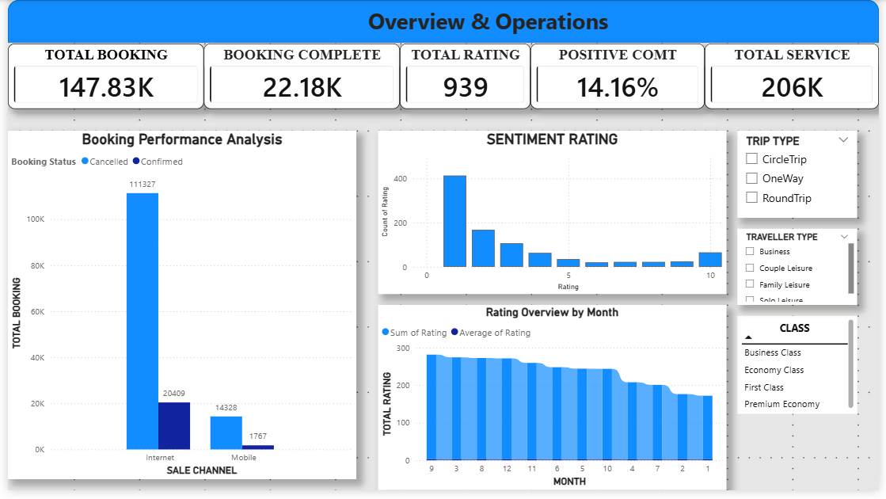
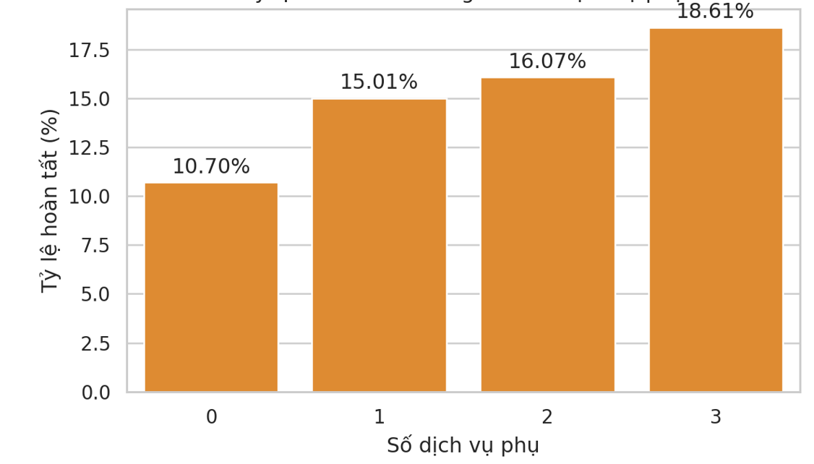
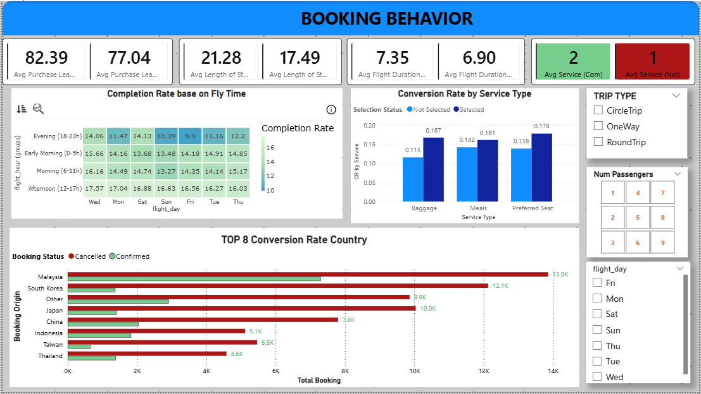

# ✈️ Flight Operations & Delay Analytics Dashboard

[](https://powerbi.microsoft.com/)
[](https://learn.microsoft.com/en-us/dax/)
[](docs/)
[]()

> An interactive end-to-end **Power BI Business Intelligence Dashboard** engineered to monitor airline on-time performance (OTP), diagnose root causes of flight delays, and identify operational bottlenecks across carriers, routes, and hub airports.

---

## 📌 Executive Summary & Problem Statement

Flight delays cost the global aviation industry billions of dollars annually while directly degrading passenger satisfaction. This project analyzes commercial flight operations data to answer three critical business questions:
1. **Operational Health:** What is the fleet-wide On-Time Performance (OTP) rate, and how does it fluctuate across seasons, days of the week, and peak operational hours?
2. **Root-Cause Attribution:** Are flight delays primarily driven by carrier-controlled factors (late turnaround, maintenance) or external factors (weather, air traffic control/NAS)?
3. **Network Bottlenecks:** Which origin-destination route pairs and transit hubs exhibit the highest delay risk?

---

## 📊 Dashboard Visual Showcase

### 1. Executive Performance & KPI Overview
| Operational KPI Overview | Flight Delay Decomposition |
| :---: | :---: |
|  |  |

### 2. Route & Hub Airport Diagnostics


---

## 🔍 Key Business Findings

* **Peak Hour Congestion:** Departure delays spike dramatically between **16:00 and 19:30**, with average departure delays nearly **2.8x higher** compared to morning departures due to ripple-effect propagation.
* **Dominant Delay Factors:** Over **48% of total delay minutes** are attributed to *Late Aircraft Inbound Delays*, proving that schedule buffer optimization between turnaround flights yields greater impact than gate boarding adjustments.
* **Hub Disparities:** Concentrated hub airports account for a disproportionate share of severe delays (>45 mins), with weather accounting for seasonal Q3 spikes.

---

## 🏗️ Data Architecture & Star Schema Model

The data pipeline was developed using **Power Query (M Language)** for ETL and structured into a dimensional **Star Schema**:

* **Fact Table:** `Fact_Flights` (Flight Date, DepTime, ArrTime, Delay Minutes, Cancellation, Metrics)
* **Dimension Tables:**
  * `Dim_Airlines` (Carrier Code, Airline Name)
  * `Dim_Airports` (Airport Code, City, State, Latitude/Longitude)
  * `Dim_Date` (Date, Day, Month, Quarter, Weekend Flag)
  * `Dim_DelayCauses` (Carrier, Weather, NAS, Security, Late Aircraft)

---

## 💡 Strategic Business Recommendations

1. **Dynamic Turnaround Buffering:** Introduce an adaptive 15-minute buffer on high-risk turnaround routes during peak afternoon blocks (16:00–19:00) to halt delay cascading.
2. **Predictive Maintenance Scheduling:** Prioritize aircraft maintenance inspections during overnight downtime rather than daytime turn blocks for older fleet segments.
3. **Hub Contingency Protocols:** Establish pre-cleared alternative routing protocols for primary bottleneck hubs during forecasted severe weather windows.

---

## 📁 Repository Structure

```text
├── dashboard/                     
│   └── Flight_Operations_Analysis.pbix    # Main interactive Power BI dashboard
├── assets/                                # High-resolution visual showcase screenshots
│   ├── overview_dashboard.png             # Executive KPI & Performance Overview
│   ├── delay_breakdown.png                # Delay decomposition & ancillary factor analysis
│   └── route_performance.png              # Route, airport & booking behavior diagnostics
├── data/                                  
│   ├── sample_data.csv                    # 1,000-row sample flight dataset
│   └── data_dictionary.md                 # Attribute definitions & data dictionary
├── docs/                                  
│   └── dax_measures.md                    # Core DAX formulas & business logic documentation
├── notebooks/                             # Exploratory Data Analysis & statistical notebooks
├── .gitignore                             # Ignored cache and temporary OS/BI files
└── README.md                              # Main documentation and executive overview
```

---

## 🚀 How to Explore This Project

1. **Interactive File:** Download `dashboard/Flight_Operations_Analysis.pbix` and open it in **Power BI Desktop**.
2. **DAX Code:** Review all analytical measures in [`docs/dax_measures.md`](docs/dax_measures.md).
3. **Data Dictionary:** Inspect dataset attributes in [`data/data_dictionary.md`](data/data_dictionary.md).

---

## 👩‍💻 Author

**Tran Cam Tu**  
*Data Science Senior @ Ho Chi Minh City University of Industry and Trade (HUIT)*  
* Career Focus: **Data Analyst / Data Quality Assurance**  
* ✉️ Email: trancamtu3518@gmail.com  
* 🔗 LinkedIn: [linkedin.com/in/trancamtu3518](https://linkedin.com)  
* 📂 GitHub: [github.com/trancamtu3518](https://github.com/trancamtu3518)
